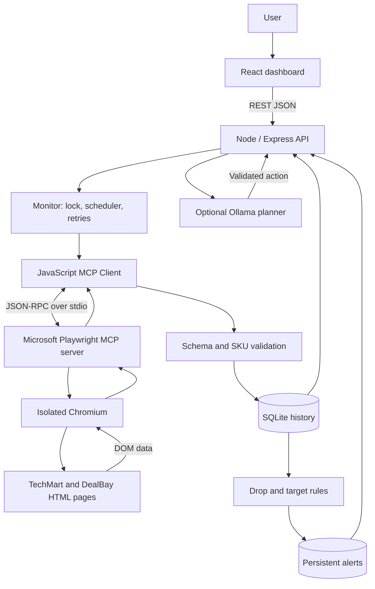

# Architecture

## Component diagram

The demo stores and API share Express, but the collector does not read their database or HTTP JSON directly. It requests browser navigation and DOM evaluation through the separately spawned MCP server. This separation is exercised in the real E2E test.

## One scan, step by step

1. A user click, timer, or validated AI action calls Monitor.run().
2. A process-local lock rejects overlapping scans with HTTP 409.
3. A running record is inserted in SQLite.
4. For each of the six known listings, the MCP client connects if needed and discovers available tools.
5. browser_navigate loads the supported local product URL in Chromium.
6. browser_evaluate reads rendered product elements and returns structured values.
7. Zod checks types, positive integer price, INR currency and stock. The monitor checks canonical SKU.
8. A transaction stores an observation and any resulting alerts. All database values use prepared statements.
9. If extraction fails, the MCP connection is closed and one retry uses a fresh session. After the second failure, that listing is logged and the scan continues.
10. The run becomes complete, partial, or failed. React refreshes immediately after actions and every five seconds.

## Tables

| Table | Key fields | Purpose |
|---|---|---|
| listings | id PK, sku, store, path UNIQUE | Canonical listing identity |
| demo | id PK/FK listings, price, stock | Mutable demo-store state |
| targets | sku PK, price | One target shared across both store listings |
| runs | id PK, started, finished, status, errors | Scan audit and errors |
| observations | id PK, listing_id FK, run_id FK, price, stock, currency, observed_at | Append-only successful measurements |
| alerts | id PK, listing_id FK, observation_id FK, kind, seen | Persistent notifications |
| settings | key PK, value | Persisted monitoring interval |

Index: observations(listing_id, id DESC). UNIQUE(observation_id,kind) prevents duplicate alert insertion for the same event. Schema setup is idempotent. Interrupted runs are marked on startup. All timestamps are UTC ISO strings; the dashboard formats them in the browser's local timezone.

## Alert semantics

- Drop: previous and current observation both in stock AND new price is lower.
- Target: current observation in stock and at/below target AND no previous observation, previous observation out of stock, or previous price above target.
- Repeating an unchanged price does not repeat an alert.
- A price can rise above target then cross down again, producing a new event.
- A first observation establishes the drop baseline. First observation can still satisfy a preconfigured target.
- Observations and their alerts commit together or roll back together.

## Why these choices?

- **MCP stdio:** real protocol boundary, tool discovery and replaceable browser service without exposing an MCP network port.
- **Known selectors:** predictable mini-project evaluation; external-site adapters need independent selectors, locale parsing and permission to automate.
- **Integer paise:** avoids floating-point currency comparison errors.
- **SQLite WAL + transactions:** durable local data without installing a database server.
- **Single scan lock:** one MCP browser must not navigate to two products concurrently.
- **React polling:** simple, inspectable and adequate at this scale; SSE/WebSockets would be an extension.
- **AI planning only:** language flexibility without granting a model arbitrary browser/code execution.
- **Two isolated clients in E2E:** the test dashboard browser cannot interrupt the monitor's navigation.

## Extending to a permitted external store

Add a reviewed store adapter, fixed origin and path rules, canonical product/variant mapping, DOM selectors, locale-aware money parser, and test fixtures. Add rate limits and a suitable scheduling interval. Account for stock, shipping, coupons and tax. Never assume titles alone identify the same variant. Current code intentionally accepts only its local demo product routes.

## Future work

Authenticated users, configurable product registration, approved external adapters, email integration, retention policies, distributed job queue, migration tooling, anomaly detection, and human-reviewed semantic product matching.
